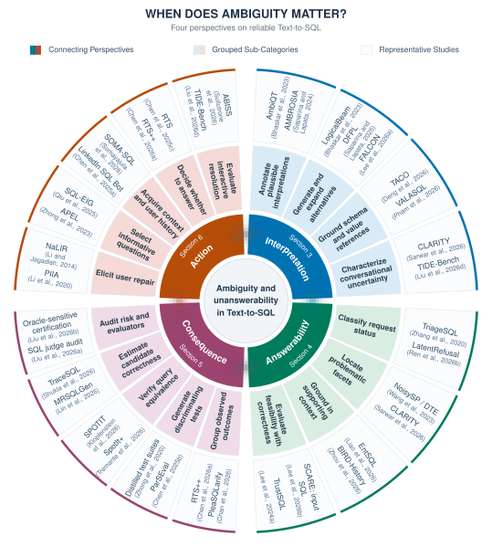

# When Does Ambiguity Matter?

**A Survey of Ambiguity and Unanswerability in Reliable Text-to-SQL**

Anonymous companion repository for the paper submission. It contains a curated reading list, a guide to benchmark evaluation, and code to check the paper's numerical analyses from included records.

## Contents

- [Papers and taxonomy](#papers-and-taxonomy)
- [Benchmarks and evaluation](#benchmarks-and-evaluation)
- [Run the analyses](#run-the-analyses)
- [Repository layout](#repository-layout)

## Papers and taxonomy

The collection contains **64 technical studies and five related surveys**. The technical literature cutoff is 05 October 2026. The quantitative analyses retain a fixed corpus with a publication cutoff of 01 October 2026.



*Figure 2. Taxonomy of ambiguity and unanswerability for reliable Text-to-SQL.*

[View full-size SVG](assets/taxonomy.svg) · [PNG version](assets/taxonomy.png)

Browse the [complete paper list](papers/README.md) for titles and source links, or the [taxonomy guide](papers/taxonomy.md) for method families. These perspectives overlap. The numerical analysis codes individual study settings and distinguishes direct answer comparison from supporting verification.

## Benchmarks and evaluation

The [benchmark guide](papers/benchmarks.md) compares **13 selected settings from 11 studies**, including alternative recovery, provided clarification, interactive resolution, and answer-or-abstain evaluation.

The accompanying analyses cover:

- **Perspective connections:** overlap, information flow, and relationship evaluation across 89 direct NL2SQL settings.
- **SCARE and TrustSQL:** reconstruct response counts, coverage, and errors from published tables.
- **AmbiQT and AMBROSIA:** check recorded query outcomes, candidate budgets, and scoring behavior.
- **CLARITY:** check conditional agreement between annotation-derived query alternatives, population exclusions, and four worked cases.

See the [analysis guide](analysis/README.md) for the mapping from paper results to scripts, inputs, and outputs.

The relationship records use the human-source-review revision of 9 October 2026: 5 of 18 Interpretation–Answerability settings have relationship evaluations. Across the six perspective pairs, the counts are 60 evaluated, 18 not found, and 20 unclear. The [source records](analysis/data/overlap/relationships/source-records.json) and anonymized review forms ([Reviewer A](analysis/data/overlap/relationships/reviews/reviewer-a.csv), [Reviewer B](analysis/data/overlap/relationships/reviews/reviewer-b.csv)) preserve the evidence and [three resolution decisions](analysis/data/overlap/relationships/reviews/resolutions.json).

## Run the analyses

From the repository root, with **Python 3.10 or later**:

```sh
python3 analysis/run.py
```

No package installation is needed. The command uses the standard library and makes no network requests or model calls. A successful run reports `pass` for each check and saves its receipt in `reproduced/numeric-validation.json`.

The default run verifies arithmetic and consistency of the included records. It does not rerun SQL, judge interpretations, or repeat human review. Optional database execution is documented separately for [AmbiQT and AMBROSIA](analysis/benchmarks/README.md) and [CLARITY](analysis/clarity/README.md), using independently obtained inputs with matching hashes.

## Repository layout

```text
README.md
papers/                  # Reading list, taxonomy, benchmark guide
assets/                  # Taxonomy figure from the paper
analysis/
  run.py                 # One command for all recorded-result checks
  package.py             # Verify and build the submission ZIP
  data/                  # Fixed inputs and recorded evidence
  checks/                # Benchmark and recorded-review consistency checks
  scare/                 # Response tradeoff reconstruction
  benchmarks/            # AmbiQT / AMBROSIA records and optional replay
  clarity/               # Agreement checks, worked cases, optional replay
reproduced/              # Generated locally; excluded from the ZIP
```

The [input guide](analysis/data/README.md) describes the data conventions and provenance records. Some individual scripts also write into their own `reproduced/` subdirectories.

Upstream code and datasets retain their original access and use terms. Download them through the links in the replay guides. For CLARITY, contact authors directly for obtaining its code and dataset.
